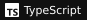
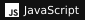
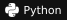
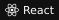
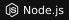
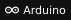
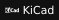

<picture><source media="(prefers-color-scheme: dark)" srcset="assets/yeti-dark.svg"></picture>

**Hudson Tinch** · finance &amp; entrepreneurship, University of Arkansas · developer since 2019

&nbsp;&nbsp;

&nbsp;&nbsp;

## Stack

## Stats

## Work

| project | lang | what it is |
|------|:----:|-------|
| [**Members Moments**](https://membersmoments.hudsontinch.com) | `JS` | Shoppable creator video for McMillon Innovation Studio's Sam's Club challenge · Demo Day, Spring 2026 |
| [**NeatFreak**](https://hudsontinch.com/demos/neatfreak) | `Python` | A photo of a tool becomes a 3D-printable drawer organizer, extracted in the browser |
| [**PixOS**](https://hudsontinch.com/PixOS/PixOS) | `JS` | Pixel art editor · GIF export · onion skinning · undo/redo |
| [**AVR Drone**](https://hudsontinch.com/projects) | `C++` | Autonomous A\* pathfinding drone · 4th at Bell AVR nationals, 2nd in presentation |
| [**Arduino R4 Controller**](https://hudsontinch.com/projects) | `C++` | WiFi servo and electromagnet control from any browser, no app needed |
| [**hudsontinch.com**](https://hudsontinch.com) | `JS` | This portfolio: an ASCII liquid hero you can strike and tilt, a WebGL sand shader, and a Windows 95 desktop hidden inside |

## Source

[**PixOS**](https://github.com/Y3t1M/PixOS) · [**Arduino R4 Controller**](https://github.com/Y3t1M/Arduino-R4-Controller-Web-Interface) · [**hudsontinch.com**](https://github.com/Y3t1M/Y3t1M.github.io)

<!-- ↑↑↓↓←→←→BA -->
